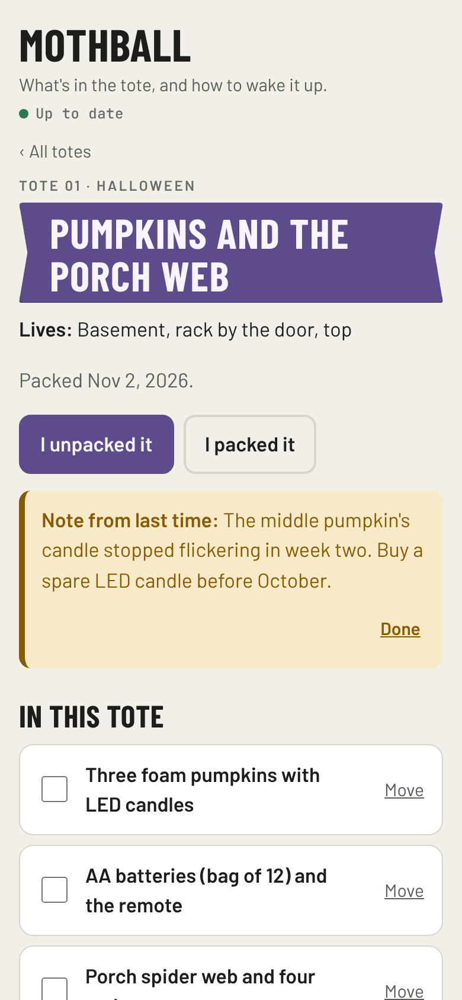
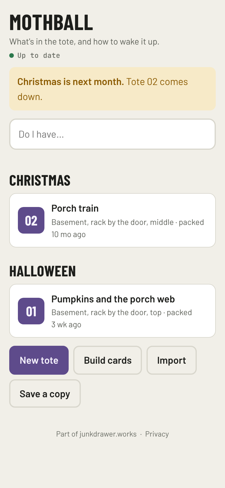

# Mothball

**Use it: [mothball.junkdrawer.works](https://mothball.junkdrawer.works/)** (writing stickers needs Chrome on an Android phone)

**What's in each seasonal tote, and how to bring every build in it back to life next year.** A sticker on each tote opens its page: the contents to tick off as you unpack, a card for each build inside (power, firmware, bring-up steps, how to point it at new Wi-Fi), and the note you left yourself when you packed it.

<p align="center">
  
  
</p>

## How it works

- **Totes.** Numbered like the marker on the box. Pack and unpack dates, where it lives, and a moving-box number while it travels.
- **Build cards.** One per build, shared by any tote it goes in: Build cards names each tote a card is in, and a tote's page says where else it is.
- **Repacking.** Move beside a contents line, or on a build card, sends it to another tote and saves both at once.
- **Do I have…?** The box on the home page finds a thing in any tote's contents, a tote by its name or a build card, each under its tote's number.
- **A note to next year.** "I packed it" asks what broke or ran out, and the tote shows it at the top next time.
- **Labels.** A printable card with the number, the builds and contents (six lines), and a QR code, to tape over the sticker.
- **Import and Save a copy.** Import fills in from a file (the starter cards), never blanking what's typed. Save a copy downloads every tote and card as a file Import reads back: after a mistake, a cleared list gets its lines back and the totes and cards deleted since are offered back, each ticked.
- **Switchboard.** Records live in your Switchboard ledger (a Google Sheet you own), so they follow you between the phone and the laptop. Connect from [tag.junkdrawer.works](https://tag.junkdrawer.works/).

## Running it

It's a static site: plain HTML, CSS and JavaScript, with no build step.

```sh
npx http-server -p 8080 -c-1 .   # then open http://localhost:8080 (add ?demo for sample data)
npm test                         # unit tests, then the page in Chromium with a pretend NFC reader
node tools/make-icons.mjs        # PNG icons from icon.svg
```

GitHub Pages serves it from `main`, `/ (root)`, at its own address (`CNAME`).

### Files

- `js/app.js`: the app.
- `js/totes.js`: a tote's state (out or put away), which lines are ticked, the home page's notice and the import, unit-tested.
- `js/sample.js`: the seasons and the sample totes.
- `js/kit/`, `css/kit.css`: the tag apps' shared kit (ledger client, Web NFC, small UI helpers).
- `fonts/`: Barlow, Barlow Condensed and JetBrains Mono (SIL Open Font License), served from here so nothing loads from elsewhere.
- `test/e2e.mjs`, `test/app-checks.mjs`: the page in Chromium, offline included.

